# Картинки выполненных ноутбуков

Ветку перезаписывает проверка при каждом обновлении `main`.

## 00_intro_data

`[2]` #@title Ваш номер участника — выдаёт преподаватель

```
Номер участника: 0. Номер 0 — те же данные, что на слайдах.
```

`[4]` #@title Обучаем модель на «лабораторных» данных

```
Обучали на 1078 цифрах, проверяем на 719 других.
Точность на таких же «лабораторных» данных: 97.2%
```

`[5]` #@title Переносим в «поле»: меняйте условия съёмки

```
Лаборатория: 97.2%   ·   поле: 27.5%
```

`[5]` #@title Переносим в «поле»: меняйте условия съёмки

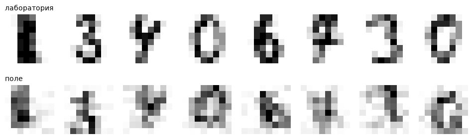

`[7]` #@title Лечим данными, а не моделью: добавим «полевые» примеры в обучение

```
Та же модель, обучение + 3 «полевые» копии каждого примера:
  лаборатория: 94.3%
  поле:        64.0%
```

`[9]` #@title Калькулятор памяти

```
Модель на 11.5 млрд параметров; у вас 16 ГБ; запас ×1.2

формат         веса, ГБ   с запасом   влезет?
FP32               42.8        51.4   нет
FP16 / BF16        21.4        25.7   нет
INT8               10.7        12.9   да
INT4 (Q4)           5.4         6.4   да
```

## 01_algorithms

`[2]` #@title Ваш номер участника — выдаёт преподаватель

```
Номер участника: 0. Номер 0 — те же данные, что на слайдах.
```

`[3]` #@title Подготовка: библиотеки и доступ к снимкам PlantVillage

```
Готово. Снимков-образцов: 14
```

`[5]` #@title Замер: сортировка против топ-K, список против хеш-таблицы

```
Отсортировать 1,000,000 чисел: 11.2 мс; найти топ-10: 2.6 мс → в 4.4 раза быстрее
Найти элемент среди 200 000: список 3110 мкс, хеш-таблица 0.06 мкс → в 50,107 раз быстрее
```

`[7]` #@title Один лист в шести вариантах

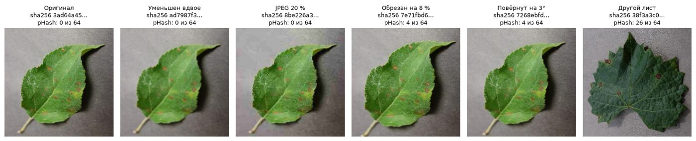

`[9]` #@title Собираем 100 снимков (около минуты)

```
Снимков: 100 · из них подмешанных копий: 12
```

`[10]` #@title Ищем почти-дубли: все пары

```
Сравнили 4,950 пар. Нашли пар с расстоянием ≤ 8: 10
Из 12 подмешанных копий нашли 10
  пропущена: копия №93 («отражён») снимка №35, расстояние 34
  пропущена: копия №99 («отражён») снимка №77, расстояние 30
```

`[10]` #@title Ищем почти-дубли: все пары

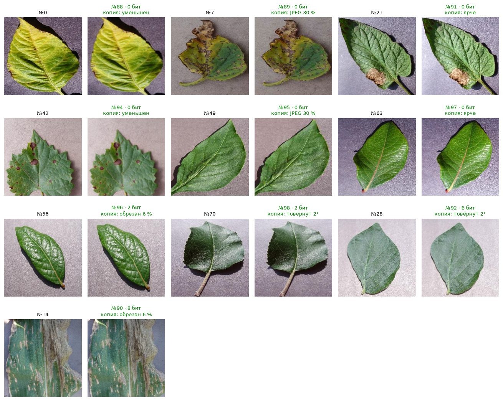

`[12]` #@title Кандидаты через хеш-таблицы

```
Кусков: 8 по 8 бит. Пар-кандидатов: 325 из 4,950 (6.6%)
Из 10 пар с расстоянием ≤ 8 среди кандидатов: 10
```

`[14]` #@title Случайное деление против деления по объектам

```
600 объектов × 4 кадров = 2400 изображений
Ошибка при случайном делении по кадрам: 0.7%
Ошибка при делении по объектам:         4.3%   ← это и есть честная оценка
```

`[16]` #@title Калькулятор фильтра Блума

```
1,000,000 элементов при доле ложных «видели» 1.00%: 1.2 МБ (9.6 бит на элемент, 7 хеш-функций)
```

`[18]` #@title Сжимаем веса и меряем точность

```
Весов: 9610. Масштаб: один на слой

формат  размер, КБ  точность
FP32          37.5     97.9%
FP16          18.8     97.9%
INT8           9.4     97.9%
INT4           4.7     97.9%
INT3           3.5     96.0%
INT2           2.3     12.0%
```

## 02_graphs

`[2]` #@title Ваш номер участника — выдаёт преподаватель

```
Номер участника: 0. Номер 0 — те же данные, что на слайдах.
```

`[3]` #@title Подготовка

```
«Отверженные»: узлов 77 · рёбер 254
```

`[3]` #@title Подготовка

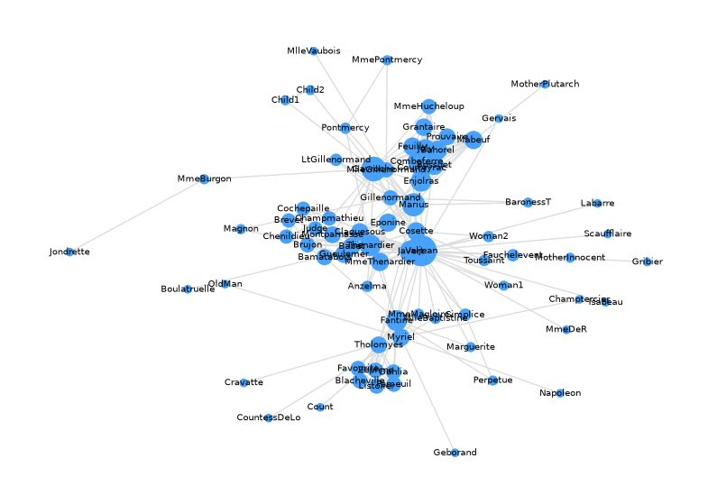

`[5]` #@title Топ-10 по трём мерам

```
В скобках — число связей персонажа
```

`[7]` #@title Сообщества Louvain

```
Групп: 6 · модулярность 0.57 (чем выше, тем чётче деление)

1. 23 персонажей · ключевые: Valjean, Marius, Javert
2. 17 персонажей · ключевые: Gavroche, Enjolras, Bossuet
3. 11 персонажей · ключевые: Fantine, Tholomyes, Dahlia
4. 10 персонажей · ключевые: Myriel, MmeMagloire, MlleBaptistine
5. 10 персонажей · ключевые: Thenardier, Eponine, MmeThenardier
6.  6 персонажей · ключевые: Bamatabois, Judge, Chenildieu
```

`[7]` #@title Сообщества Louvain

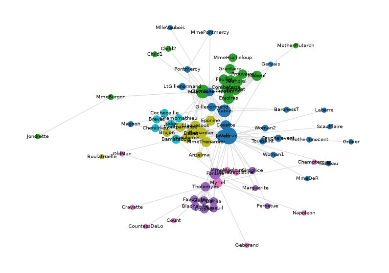

`[9]` #@title Сравниваем методы по ROC-AUC

```
Спрятали 25 рёбер и взяли 25 пар без связи. ROC-AUC: 0,5 — монетка, 1,0 — без ошибок

Общие соседи            0.83
Жаккар                  0.78
Adamic–Adar             0.85
Векторы узлов (8)       0.71
```

`[11]` #@title Метки расходятся по графу

```
Шагов: 3. Угадали клуб у 33 из 34 · похожесть узлов друг на друга 53%
```

`[11]` #@title Метки расходятся по графу

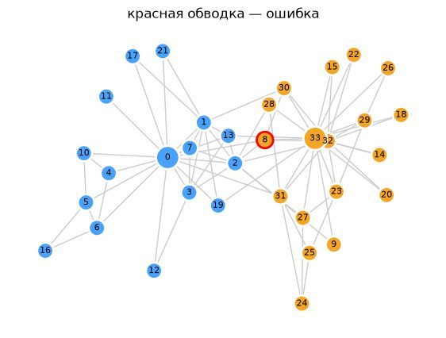

## 03_data_collection_labeling

`[2]` #@title Ваш номер участника — выдаёт преподаватель

```
Номер участника: 0. Номер 0 — те же данные, что на слайдах.
```

`[4]` #@title Учебная страница: разбор по CSS-селекторам

```
Найдено новостей: 12 → сохранено в news_offline.csv (значок папки слева)
```

`[6]` #@title Парсим живую страницу

```
Код ответа: 200 (200 — всё хорошо; 403 — сайт не пускает; 429 — слишком часто)

Повторяются чаще всего (кандидаты в item_selector):
  125 × span.menu__item-text
  118 × li.menu__item
  116 × a.menu__link
   58 × a.dropdown-item
   46 × a.btn.btn-soft-secondary.btn-xs.mb-1
   24 × a.menu__link.pe-8
   24 × i.menu__link_btn.fa-light.fa-circle-ellipsis.me-n8
   23 × li.menu__item.menu__item--has-children
   18 × ul.menu__list._level--2.m-0.p-0
   16 × div.col-sm-6.col-lg-6.mb-3.mb-lg-5
   16 × a.card.h-100.card-transition
   16 × div.card-pinned
   16 × img.card-img-top
   16 × span.card-pinned-top-end
   16 × span.badge.bg-primary.rounded-pill.fw-normal.px-2
   16 × div.card-body.p-lg-5
   16 × h5.mb-3
   16 × p.small.text-muted.mb-0
   11 × a.w-100.mob__tile
   11 × span.mob__tile-text.text-white
   10 × div.dropdown-divider
   10 × li.list-pointer-item
   10 × a.link-sm.link-secondary
    9 × a.page-link
    9 × a.link-sm.link-light
    7 × svg.img-fluid
    7 × a.btn.btn-soft-light.btn-xs.btn-icon
    6 × li.hs-has-sub-menu.nav-item.d-flex.position-relative
    6 × a.hs-mega-menu-invoker.mainmenu-item
    6 × div.col-3
    6 × li.page-item
    6 × div.row.align-items-center
    6 × div.col.pe-0
    6 × h5.mb-0.small
    6 × h5.text-primary.fw-medium.mb-3
    6 × li.list-inline-item.mb-3.mb-sm-0
    6 × ul.menu__list._level--1.m-0.p-0
    5 × a.hs-mega-menu-invoker.topbar-item
    5 × div.hs-sub-menu.dropdown-menu.text-nowrap
    5 × li.list-inline-item
```

`[8]` #@title Учебный магазин: три страницы → CSV и цены

```
страница 1: код 200
страница 2: код 200
страница 3: код 200
Собрано книг: 60 → books.csv
```

`[8]` #@title Учебный магазин: три страницы → CSV и цены

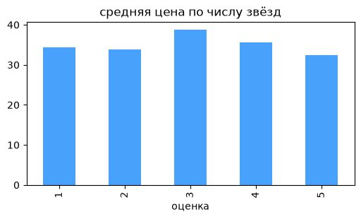

`[10]` #@title Обход страниц и график

```
Шаблон пуст — строим по учебной странице
```

`[10]` #@title Обход страниц и график

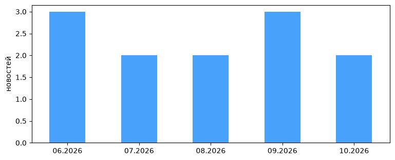

`[12]` #@title Подготовка: библиотеки и доступ к снимкам PlantVillage

```
Готово. Снимков-образцов: 14
```

`[13]` #@title Три снимка одного листа

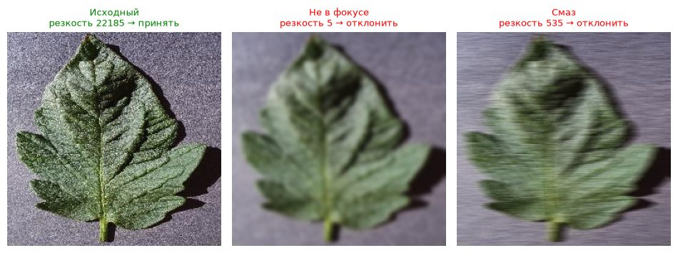

`[14]` #@title Прогоняем контроль по 60 случайным снимкам набора

```
Резкость: от 38 до 20595; ниже порога 1000: 20 из 60
Снимков, где больше 5 % пикселей пересвечены или провалены в чёрное: 2
```

`[14]` #@title Прогоняем контроль по 60 случайным снимкам набора

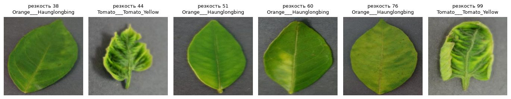

`[16]` #@title Галерея: 50 снимков для разметки (около 30 секунд)

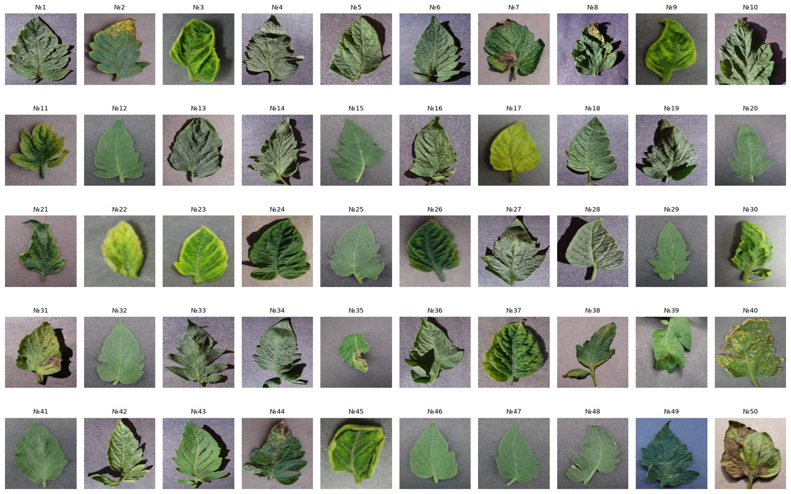

`[17]` #@title Считаем согласие и каппу Коэна

```
ДЕМО: ответов нет (или в строке не 50 цифр) — моделируем двух разметчиков с 10 % и 25 % ошибок

Совпали ответы: 72%  ·  каппа Коэна: 0.44
Совпадение с меткой набора: A — 88%, B — 76%
Спорные снимки: №2, №3, №6, №9, №10, №13, №14, №17, №20, №21, №39, №43, №47, №49
```

`[17]` #@title Считаем согласие и каппу Коэна

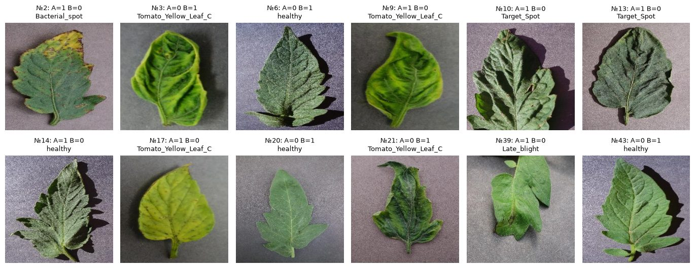

`[19]` #@title Ловушка: высокий процент совпадений при нулевой каппе

```
Здоровых 95%. «Всегда здоров» совпадает с истиной в 94% случаев, каппа 0.00
```

`[21]` #@title Моделирование: 1 000 снимков, 3 класса, 5 разметчиков

```
Лучший разметчик в одиночку: 92.2%
Большинство из 5:            93.7%
Dawid–Skene из 5:            95.7%

Точность разметчиков: настоящая → оценённая без эталона
  1: 0.92 → 0.91
  2: 0.84 → 0.85
  3: 0.67 → 0.67
  4: 0.54 → 0.54
  5: 0.54 → 0.54
```

## 04_computer_vision

`[2]` #@title Ваш номер участника — выдаёт преподаватель

```
Номер участника: 0. Номер 0 — те же данные, что на слайдах.
```

`[3]` #@title Подготовка: библиотеки и доступ к снимкам PlantVillage

```
Готово. Снимков-образцов: 14
```

`[5]` #@title Пиксели одного пятна

```
Размер снимка: (256, 256, 3) → 196608 чисел
Канал R (красный) в квадрате 6 × 6 вокруг самого большого пятна:
[[ 84  89  90  85 104 105]
 [ 83  94  96 100 113 107]
 [100 109 105 107 100  86]
 [107 110  98 113  94  87]
 [115 104  94 112 105 102]
 [123 116 105 112 100 100]]
```

`[5]` #@title Пиксели одного пятна

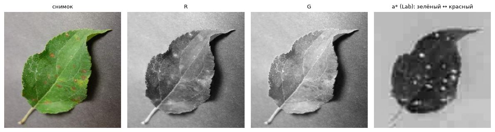

`[7]` #@title Классика за три шага

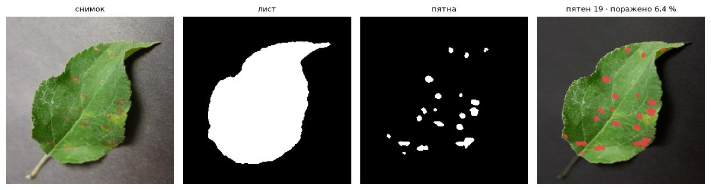

`[8]` #@title То же правило на десяти листьях

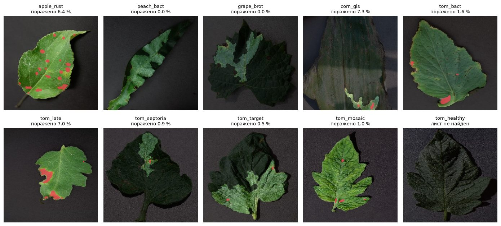

`[10]` #@title SAM по клику (первый запуск скачивает модель ≈ 375 МБ)

```
Warning: You are sending unauthenticated requests to the HF Hub. Please set a HF_TOKEN to enable higher rate limits and faster downloads.

Loading weights:   0%|          | 0/314 [00:00<?, ?it/s]
Loading weights: 100%|██████████| 314/314 [00:00<00:00, 3701.52it/s]
```

`[10]` #@title SAM по клику (первый запуск скачивает модель ≈ 375 МБ)

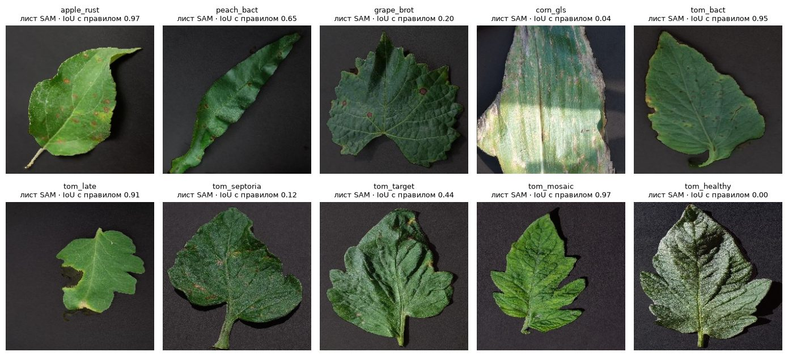

`[11]` #@title Пятно: подсказка точкой и подсказка рамкой

```
Точка: варианты [10169, 21682, 22257] пикс. — пятно правила 241.0 пикс.
Рамка: 600 пикс.; IoU с пятном правила 0.40
```

`[11]` #@title Пятно: подсказка точкой и подсказка рамкой

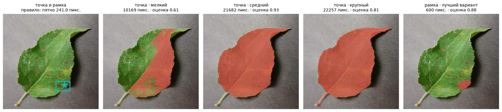

`[14]` #@title Энкодер один раз — декодер на каждый клик

```
Энкодер: 7.22 с на снимок. Декодер: 134, 99, 98 мс на клик (первый клик дольше — прогрев). Энкодер медленнее декодера в 73 раз.
Площадь масок, пикс.: клик в лист — 30706, клик в пятно — 39, клик в фон — 32417
```

`[14]` #@title Энкодер один раз — декодер на каждый клик

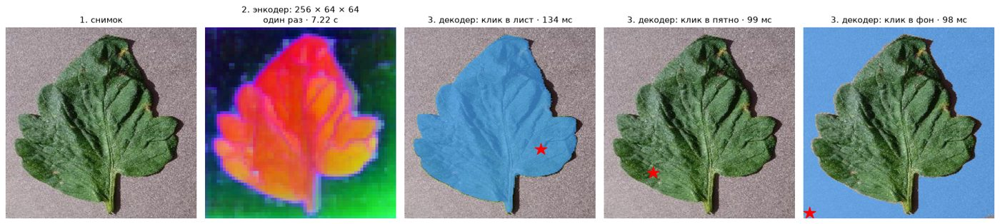

`[16]` #@title Окно, ядро и отклик

```
Окно яркости 3 × 3 на сильном крае листа:
[[111 125 194]
 [102 119 203]
 [111 131 186]]
Ядро:
[[-1.  0.  1.]
 [-2.  0.  2.]
 [-1.  0.  1.]]
Отклик = сумма попарных произведений = 360.0
```

`[16]` #@title Окно, ядро и отклик

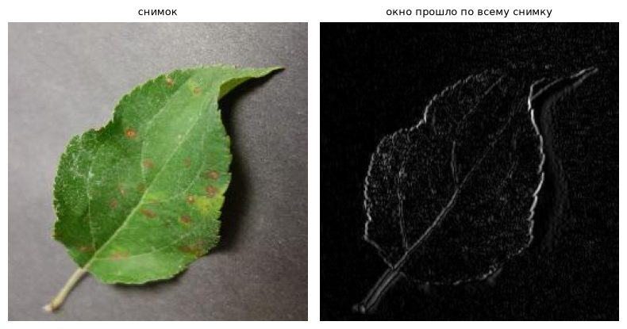

`[18]` #@title Калькулятор IoU и NMS

```
IoU эталона и модели: 0.47  (часто засчитывают попадание при IoU ≥ 0,5)
IoU с лучшей рамкой (0,92): [0.6, 0.68]
NMS с порогом 0.5: остались рамки с уверенностью [0.92]
```

`[20]` #@title Собираем данные: 5 классов томата (около минуты)

```
здоровый                   обучение 100 · проверка  50
бактериальная пятнистость  обучение 100 · проверка  50
фитофтороз                 обучение 100 · проверка  50
септориоз                  обучение 100 · проверка  50
мишеневидная пятнистость   обучение   5 · проверка  15
```

`[21]` #@title Признаки готовой сети + новый последний слой

```
Downloading: "https://download.pytorch.org/models/resnet18-f37072fd.pth" to /home/runner/.cache/torch/hub/checkpoints/resnet18-f37072fd.pth

  0%|          | 0.00/44.7M [00:00<?, ?B/s]
 21%|██        | 9.38M/44.7M [00:00<00:00, 98.3MB/s]
 98%|█████████▊| 43.9M/44.7M [00:00<00:00, 253MB/s] 
100%|██████████| 44.7M/44.7M [00:00<00:00, 231MB/s]
«Всегда самый частый класс»: accuracy 23.3% · macro-F1 0.08
Готовая сеть + новый слой:   accuracy 89.8% · macro-F1 0.80

                           precision    recall  f1-score   support

                 здоровый       0.83      0.98      0.90        50
бактериальная пятнистость       0.92      0.94      0.93        50
               фитофтороз       0.94      0.94      0.94        50
                септориоз       0.90      0.94      0.92        50
 мишеневидная пятнистость       1.00      0.20      0.33        15

                 accuracy                           0.90       215
                macro avg       0.92      0.80      0.80       215
             weighted avg       0.91      0.90      0.88       215
```

`[21]` #@title Признаки готовой сети + новый последний слой

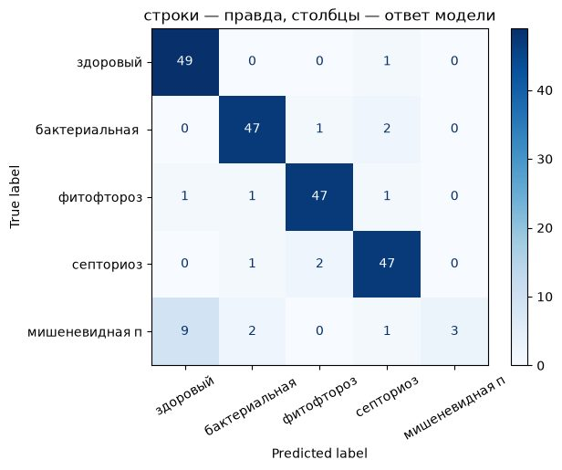

`[24]` #@title Лист → слои сети → вектор → ответ

```
Ответ: септориоз, 1.00 · правда: септориоз
```

`[24]` #@title Лист → слои сети → вектор → ответ

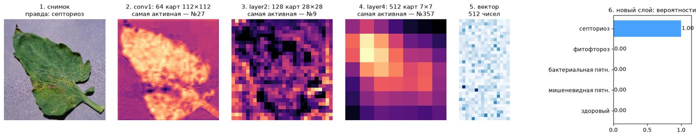

`[26]` #@title Обучение по шагам: общая ошибка и один лист

```
Шаг 0: «фитофтороз», 0.12 за правильный класс — веса случайные.
Шаг 100: «септориоз», 0.97 за правильный класс.
Впервые ответил правильно на шаге 11.
```

`[26]` #@title Обучение по шагам: общая ошибка и один лист

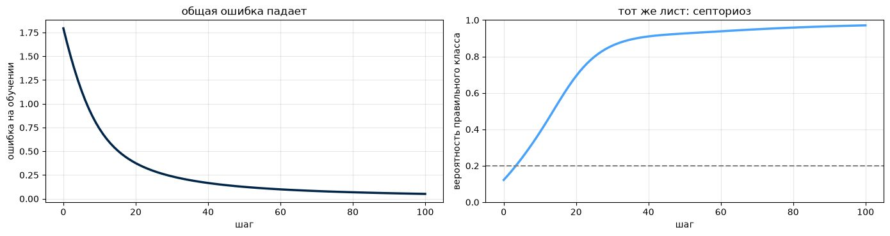

`[28]` #@title Уверенность против правоты

```
ECE — средний разрыв между уверенностью и правотой: 0.045
```

`[28]` #@title Уверенность против правоты

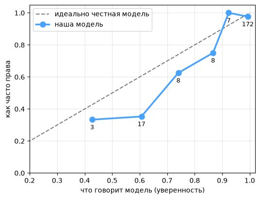

`[30]` #@title Случайный отбор против «сначала неуверенные»

```
20 размечено: случайно 52.5% · active learning 52.5%
  40 размечено: случайно 77.7% · active learning 77.5%
  60 размечено: случайно 81.6% · active learning 88.2%
  80 размечено: случайно 86.5% · active learning 90.9%
 100 размечено: случайно 89.2% · active learning 91.9%
 150 размечено: случайно 91.3% · active learning 95.5%
 200 размечено: случайно 93.2% · active learning 96.6%
 300 размечено: случайно 94.0% · active learning 97.2%
 400 размечено: случайно 94.8% · active learning 97.3%
```

`[30]` #@title Случайный отбор против «сначала неуверенные»

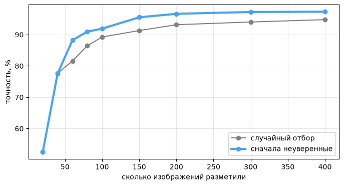
